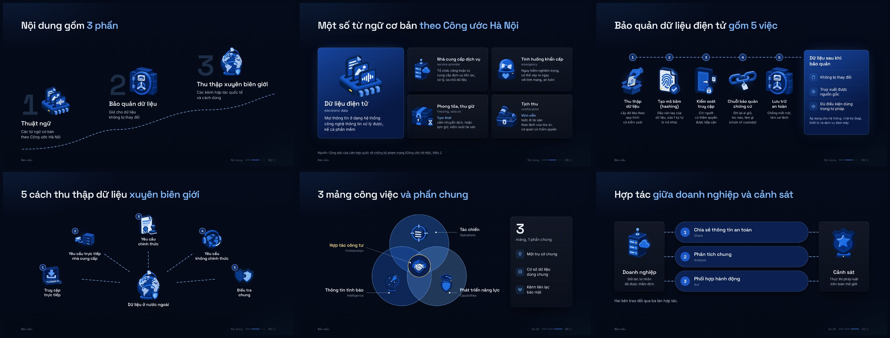

<div align="center">

# Slide Deck

**Premium talk decks with custom illustrations and an editable PowerPoint, made with Claude Code.**

[](https://claude.com/claude-code)
[](LICENSE)



<sub>Slides from the sample deck in this repo. Each one uses a different composition.</sub>

</div>

---

## What it does

You give Claude the speaker's outline and say who is in the room. Claude then:

1. **Copies the starter deck** and sets up names, sections and logos.
2. **Writes the slides** in plain language, following the outline's order and numbers.
3. **Generates illustrations** in one pseudo-3D family and one colour, through the Codex CLI.
4. **Gives each slide its own shape**: steps, bento, pipeline, hub and spokes, rows, Venn, bridge, maps.
5. **Checks every slide** by looking at it, in the browser render and in a PowerPoint render.
6. **Exports** a web deck, an editable PowerPoint with speaker notes, a PDF and a speaker script.

## Why it's different

| | |
|---|---|
| **Easy to follow** | Plain headlines, a few short lines per slide, line breaks set by meaning. |
| **Illustrated** | Every content slide has graphics from one family, not rows of icons. |
| **Varied** | No two neighbouring slides share a layout. |
| **Editable** | The PowerPoint keeps real text boxes, so the speaker can still change words. |

## Install

```bash
/plugin marketplace add tadyuh76/slide-deck-skill
/plugin install slide-deck@slide-deck-skill
```

Or copy `skills/slide-deck` into your Claude Code skills folder.

## Needs

- Node 20 or newer, Docker, and Playwright's Chromium (`npx playwright install chromium`).
- The Codex CLI, signed in, for illustrations. The starter ships 47 finished ones.
- Microsoft PowerPoint on a Mac, only for embedding fonts in the PowerPoint.

## What's inside

- `skills/slide-deck/SKILL.md` is the workflow and the rules.
- `skills/slide-deck/starter/` is a working deck: the slide engine, 12 sample slides, the illustration tools, two style reference sheets and the release pipeline.

Fonts are Space Grotesk, Inter and JetBrains Mono, under the SIL Open Font License. Map shapes come from Natural Earth.

## License

MIT
